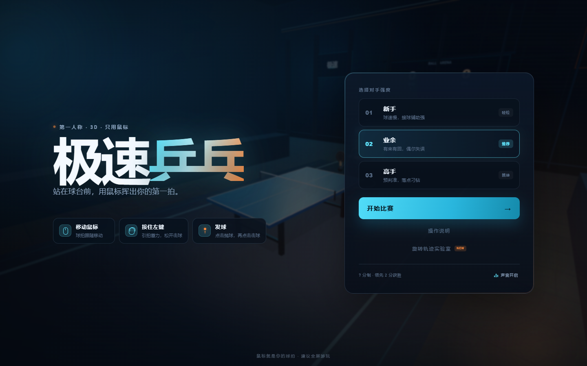
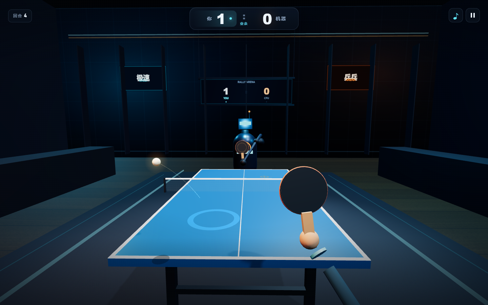
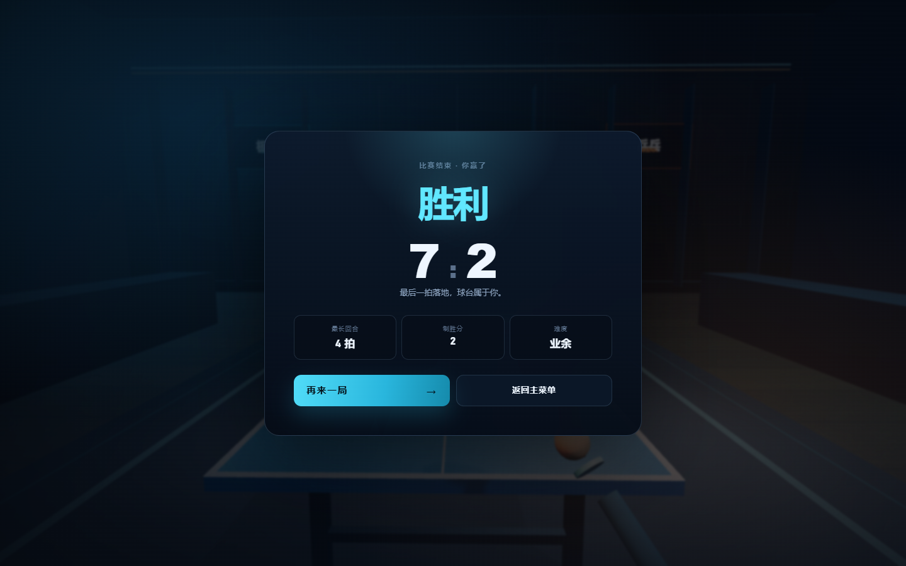
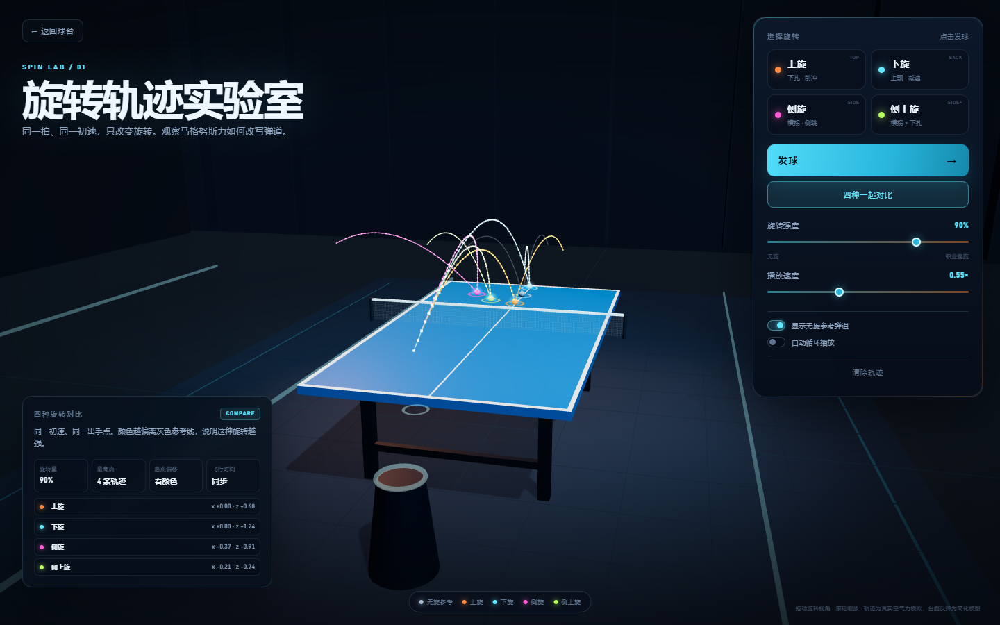

# 极速乒乓 · 第一人称 3D 乒乓球

一个只用鼠标就能玩的浏览器 3D 乒乓球小游戏。你站在球台一端，以第一人称视角和机器选手对打：移动鼠标控制球拍，按住左键引拍，松开击球。



## 快速开始

需要 Node.js 20.19+（推荐 22 或 24）。

```bash
cd pingpong
npm install
npm start
```

打开终端里输出的地址：`http://127.0.0.1:4173/`。

Windows 下也可以直接双击项目里的 `play.cmd`：它会启动本地服务器并自动打开浏览器。

也可以构建生产版本：

```bash
npm run build
npm run preview
```

生产版地址：`http://127.0.0.1:4174/`。

## 操作

| 操作 | 效果 |
| --- | --- |
| 移动鼠标 | 球拍在身前左右、上下移动 |
| 按住左键 | 引拍蓄力，球拍稍微后撤 |
| 松开左键 | 挥拍击球；蓄力越足，球速越快 |
| 发球时点击一次 | 抛球 |
| 发球时再点击一次 | 击球；鼠标位置决定大致落点 |
| `Esc` | 暂停 / 继续 |
| `M` | 静音开关（可选，鼠标也能操作） |

游戏内所有菜单、难度选择、暂停和结算都可以只用鼠标完成。建议使用桌面版 Chrome 或 Edge，并全屏游玩。

## 已实现

- 固定第一人称视角、3D 球台、球网、体育馆和第一人称球拍 / 手臂
- 球拍跟随鼠标，左键蓄力 / 松开击球，带挥拍动画和镜头反馈
- 自定义固定步长乒乓球物理：重力、空气阻力、基础旋转、台面反弹、球网碰撞
- 发球辅助：点击抛球、再点击击球；发球先落己方台面再落对方台面
- 7 分制、领先 2 分获胜、每 2 分换发、6 平后每球换发
- 三档规则型 AI：新手 / 业余 / 高手，带反应延迟、移动速度、预判误差和失误率
- 接球辅助：球拍有效区扩大、来球落点圈、回球目标圈；难度越高辅助越弱
- 球体拖尾、落点阴影、击球火花、得分提示、合成音效
- 中文主菜单、操作教学、暂停、结算、再来一局、难度重选
- 机器人对手：躯干、头部、发光面罩、可移动球拍和手臂
- 旋转轨迹实验室：三维旋转、空气阻力、马格努斯力、简化旋转反弹





## 旋转轨迹实验室

从主菜单点击「旋转轨迹实验室」，或直接打开 `http://127.0.0.1:4173/lab.html`。



实验室用同一出手点、同一初速，只改变旋转，直观对比：

- **上旋**：马格努斯力向下，弧线提前下扎，落点更近
- **下旋**：马格努斯力向上，球更飘，落点更远
- **侧旋**：空中横向拐弯，落点向侧面偏移
- **侧上旋**：横拐 + 下扎的复合曲线
- **无旋参考**：灰色基准轨迹

可调旋转强度、播放速度和是否显示参考轨迹；左下角对比列表会给出每种旋转的横向/纵向落点偏移。拖动可旋转视角，滚轮缩放。

当前实验室使用三维角速度、空气阻力、马格努斯力和旋转衰减；台面反弹为简化模型，还没有接入正式对战的球拍碰撞与瞄准补偿。

## 设计说明

### 为什么镜头不自由转头

第一人称里鼠标通常用来转头，但这个游戏里鼠标还要控制球拍。两者同时做会互相打架，所以首版采用**固定朝前**的镜头：镜头只轻微跟随鼠标，鼠标专心控制球拍。这样更像“站在球台前”，也更容易上手。

### 接球辅助

3D 深度判断对鼠标操作很不友好，所以球拍有效区比视觉拍面略大，来球接近时会有落点圈，发球和回球也有目标提示。辅助强度跟难度走：

- 新手：球速慢，AI 反应慢，球拍辅助区最大
- 业余：有来有回，AI 会主动变线，也会失误
- 高手：AI 预判更准、移动更快、落点更刁钻，辅助区最小

### 规则

- 先到 7 分且领先 2 分获胜
- 每 2 分换发；6 平后每球换发
- 发球必须先在己方台面弹一次，再落到对方台面
- 发球失误、回球出界、下网、球在己方台面二次落台都会判分
- 发球擦网后落到有效区域会重发

## 项目结构

```text
pingpong/
├─ index.html                 # 页面结构、菜单/HUD/教学/结算
├─ lab.html                   # 旋转轨迹实验室页面
├─ src/
│  ├─ main.js                 # UI 事件绑定、启动入口、调试接口
│  ├─ styles.css              # 主游戏界面样式
│  ├─ game/
│  │  ├─ constants.js         # 球台尺寸、物理参数、难度参数、镜头参数
│  │  ├─ utils.js             # 数学工具
│  │  ├─ physics.js           # 球体物理、弹道、落点预测
│  │  ├─ ai.js                # 机器选手控制器
│  │  ├─ world.js             # Three.js 场景、球台、机器人、球拍、特效
│  │  ├─ audio.js             # WebAudio 合成音效
│  │  ├─ input.js             # 鼠标输入
│  │  ├─ ui.js                # DOM 界面状态
│  │  └─ game.js              # 比赛状态机、发球、判分、回合流程
│  └─ lab/
│     ├─ spinPhysics.js       # 3D 旋转、阻力、马格努斯力、轨迹模拟
│     ├─ lab.js               # 实验室场景、轨迹、交互
│     └─ lab.css              # 实验室界面样式
├─ vite.config.js             # Vite 多页面构建配置\n├─ serve.mjs                  # 零依赖本地静态服务器
└─ package.json
```

## 调手感

大部分手感参数集中在 `src/game/constants.js`：

- `PLAYER.X_OFFSET` / `X_LEFT_RANGE` / `X_RIGHT_RANGE`：球拍在屏幕上的横向活动范围
- `PLAYER.Y_MIN` / `Y_MAX`：球拍上下活动范围
- `PLAYER.PADDLE_RADIUS`：球拍拍面大小
- `DIFFICULTIES.*.playerAssist`：玩家接球辅助强度
- `DIFFICULTIES.*.reaction` / `maxSpeed` / `predictionError`：AI 手感
- `BALL.GRAVITY` / `DRAG` / `RESTITUTION`：球的物理感
- `SERVE.*`：抛球高度、发球落点和飞行时间

相机视角在 `CAMERA` 里调整。

## 开发说明

- 渲染：Three.js
- 物理：项目内自写固定步长模拟（180Hz），没有引入重型物理引擎
- 音效：WebAudio 实时合成，不依赖外部音频文件
- 资源：所有纹理和模型均由代码生成，可离线运行
- 本地服务：`serve.mjs` 零依赖，`npm start` 直接启动

如果只想快速看生产版：

```bash
npm run build
npm run preview
```

构建时如果遇到 Windows 临时目录权限问题，可以把 `TEMP` 和 `TMP` 指向项目内目录再构建，例如 PowerShell：

```powershell
$env:TEMP="$PWD\.tmp"
$env:TMP="$PWD\.tmp"
npm run build
```
